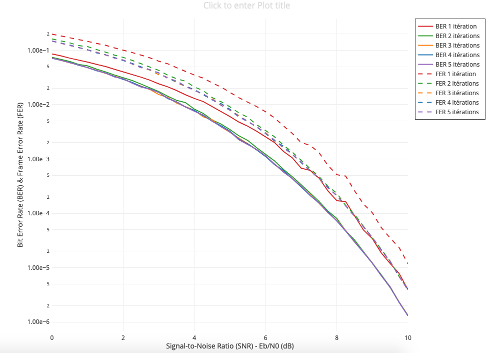
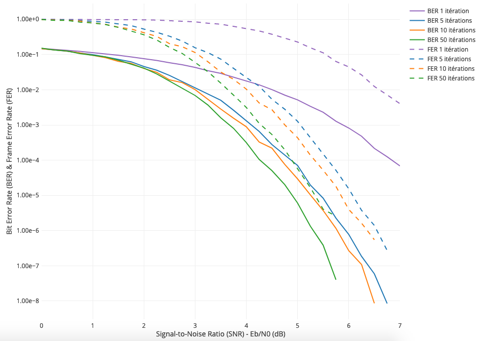
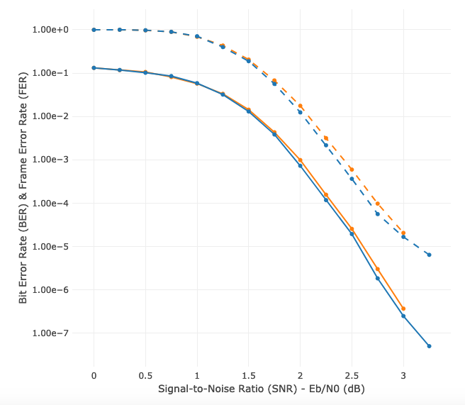

## Cours
- [Codes LDPC](/assets/cours/TS345/slides/CNUM3_LDPC.pdf)
- [Codes polaires](/assets/cours/TS345/slides/CNUM3_Polaires.pdf)
- [Partiel 2020/2021](/assets/cours/TS345/slides/partiel_2020_2021.pdf)

## Travaux pratiques

- [Sujet du TP](/assets/cours/TS345/TP/TP_TS345.pdf)

Pour faciliter vos tests, voici les courbes de performances obtenues pour les codes des fichiers
`DEBUG_6_3.alist`, `CCSDS_64_128.alist` et `MAC_KAY_504_1008.alist`.

### `DEBUG_6_3.alist` — décodage BP de 1 à 50 itérations

### `CCSDS_64_128.alist` — décodage BP de 1 à 50 itérations

### `MAC_KAY_504_1008.alist` — décodage BP avec 50 et 100 itérations

